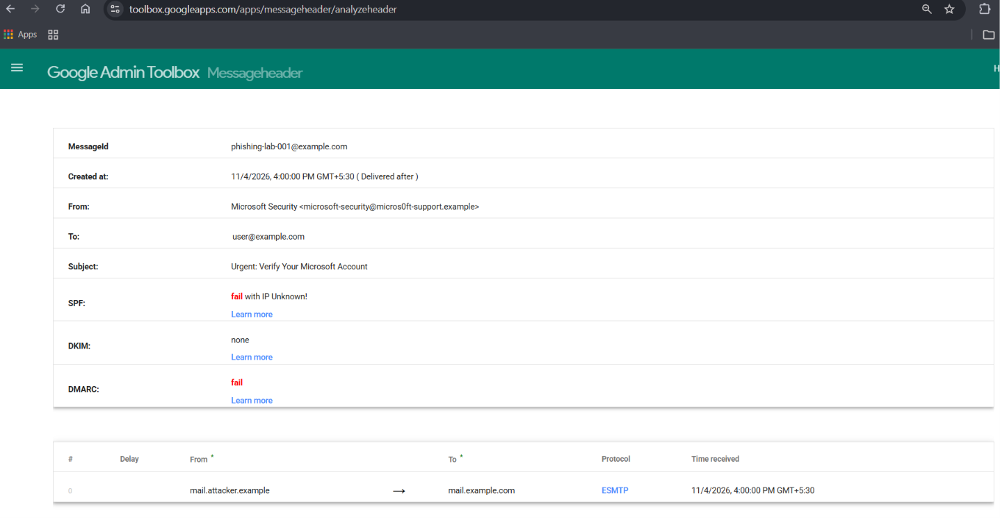
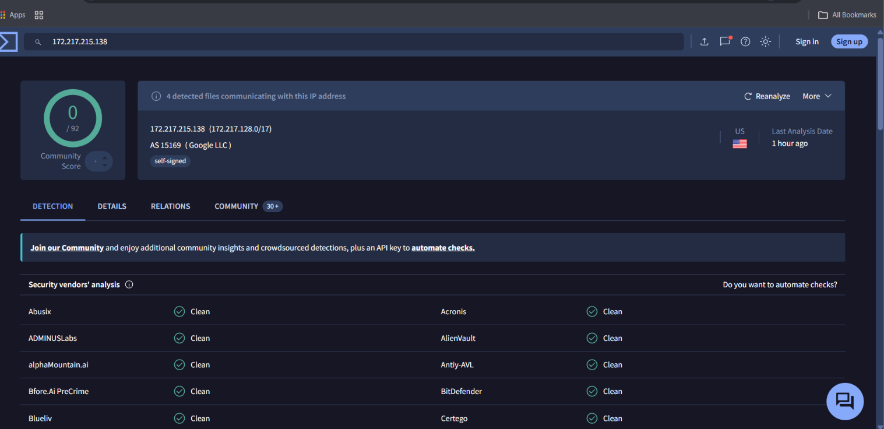
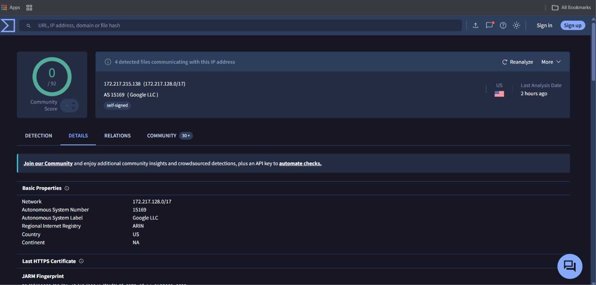

# Phishing Email Investigation Lab

## Project Overview

This project demonstrates a structured Level 1 Security Operations Center (SOC) investigation of a simulated phishing email.

The investigation focuses on identifying email spoofing indicators, examining email authentication results, analysing URL and IP reputation, reviewing infrastructure information, and documenting findings in an incident report.

The objective is to demonstrate practical phishing investigation techniques used by entry-level SOC analysts.

## Investigation Objectives

* Identify suspicious sender addresses and brand impersonation.
* Examine email headers and authentication results.
* Understand SPF, DKIM, and DMARC failures.
* Investigate suspicious URLs and domains.
* Review IP reputation using VirusTotal.
* Examine IP infrastructure and ASN information.
* Document findings and recommend appropriate security actions.

## Tools Used

| Tool                               | Purpose                                          |
| ---------------------------------- | ------------------------------------------------ |
| Google Admin Toolbox Messageheader | Email header analysis                            |
| VirusTotal                         | IP, URL, and domain reputation analysis          |
| GitHub                             | Investigation documentation and evidence storage |

## Repository Structure

```text
phishing-email-investigation-lab/
│
├── Evidence/
│   └── sample-phishing-email.txt
│
├── Analysis/
│   ├── url-analysis.md
│   └── domain-analysis.md
│
├── Reports/
│   └── phishing-incident-report.md
│
├── Screenshots/
│   ├── README.md
│   ├── 01-email-header-analysis.png
│   ├── 02-virustotal-ip-detection.png
│   └── 03-ip-infrastructure-analysis.png
│
├── Playbooks/
│   └── phishing-investigation-playbook.md
│
└── README.md
```

## Investigation Workflow

### 1. Email Examination

Reviewed a simulated email impersonating Microsoft Security.

Indicators examined:

* Suspicious sender address.
* Brand-name impersonation.
* Suspicious URL structure.
* Urgent account-verification language.
* Email authentication results.

### 2. Email Header Analysis

Used Google Admin Toolbox Messageheader to examine the simulated email header.

Authentication results:

| Authentication Mechanism | Result |
| ------------------------ | ------ |
| SPF                      | FAIL   |
| DKIM                     | NONE   |
| DMARC                    | FAIL   |

These results indicate that the simulated message failed the examined authentication checks.

### 3. URL and Domain Analysis

Examined the suspicious URL and domain characteristics.

Areas of investigation:

* Domain spelling and brand impersonation.
* URL structure and suspicious paths.
* Domain reputation.
* Registration and infrastructure information, where available.
* Potential indicators requiring further investigation.

The `.example` domain used in the simulated email is reserved for documentation and testing. It is not a real phishing domain.

### 4. IP Reputation Analysis

Used VirusTotal to examine the separately observed IP address:

`172.217.215.138`

Reviewed vendor detection results and reputation information.

The observed results included clean classifications from multiple security vendors.

A clean result does not establish that an IP address is universally safe. Reputation results must be interpreted alongside other investigation evidence.

### 5. IP Infrastructure Analysis

Reviewed the IP's infrastructure information, including:

* Network range.
* Autonomous System Number (ASN).
* Network owner.
* Geographic information.

The observed infrastructure was associated with Google LLC and ASN 15169.

**Important:** This IP infrastructure observation is separate from the simulated phishing domain. No evidence establishes that this IP hosted or operated the simulated phishing domain.

## Investigation Evidence

### Email Header Analysis



### VirusTotal IP Detection



### IP Infrastructure Analysis



## Key Findings

1. The simulated email contained indicators consistent with brand impersonation.
2. The simulated email failed SPF and DMARC authentication checks.
3. DKIM authentication was not present in the analysed sample.
4. The URL and domain were examined for suspicious characteristics.
5. The separately investigated IP showed Google-associated infrastructure.
6. The available evidence does not establish a real phishing campaign or a compromised system.

## Recommended SOC Analyst Actions

If investigating a similar real-world alert:

1. Preserve the original email and complete headers.
2. Validate sender identity and authentication results.
3. Analyse suspicious URLs without opening them directly.
4. Check domain and IP reputation using trusted threat-intelligence sources.
5. Investigate redirects, related domains, and other indicators.
6. Search SIEM logs for interactions with suspicious URLs or domains.
7. Determine whether users clicked the link or submitted credentials.
8. Escalate confirmed malicious activity according to the incident-response procedure.
9. Document findings and recommend containment actions where necessary.

## Skills Demonstrated

* Phishing email identification.
* Email header analysis.
* SPF, DKIM, and DMARC interpretation.
* URL and domain investigation.
* VirusTotal threat-intelligence analysis.
* IP reputation and infrastructure analysis.
* Security evidence documentation.
* Incident reporting.
* SOC Level 1 investigation workflow.

## Limitations and Disclaimer

This is an educational portfolio project using simulated phishing email evidence.

The `.example` domain is reserved for documentation and testing. The email authentication results are associated with a constructed sample and should not be interpreted as evidence from a real phishing campaign.

The IP investigation is a separate infrastructure observation and is not attributed to the simulated phishing domain.

No actual compromise, credential theft, or malicious campaign is claimed.

## Conclusion

This project demonstrates a structured phishing investigation workflow, from initial email examination and authentication analysis to threat-intelligence review and incident documentation.

It highlights the importance of correlating multiple indicators rather than relying on a single reputation result or authentication failure to determine whether an email is malicious.

